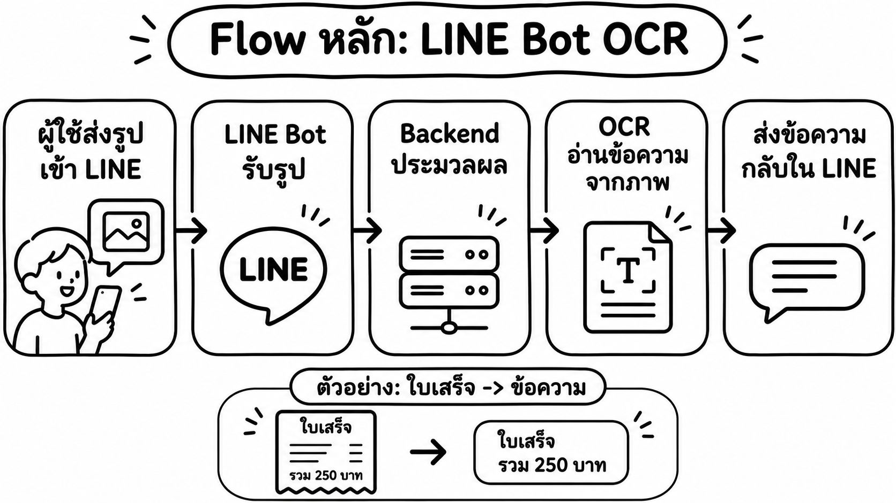

# LINE Bot Thai OCR

ส่งรูปหรือ PDF เข้า **LINE OA** แล้วรับข้อความไทย/อังกฤษ พร้อมค่าความมั่นใจและเวลาประมวลผล ใช้ [OpenThai2.0-OCR-Text ของ iApp Technology](https://huggingface.co/iapp/OpenThai2.0-OCR-Text) บน CPU ไม่ใช้ Paid OCR API, GPU หรือฐานข้อมูล

- ใช้งานผ่าน LINE เท่านั้น ไม่มีหน้าเว็บทดลอง
- มี loading animation ระหว่างอ่านภาพในแชตส่วนตัว
- รองรับ JPEG, PNG และ WebP ภาพนิ่ง ไม่เกิน **4 MB / 16 ล้านพิกเซล**
- รองรับ PDF ไม่ติดรหัสผ่าน ไม่เกิน **4 MB / 3 หน้า** แปลงแต่ละหน้าเป็นภาพก่อน OCR
- ใช้ JavaScript: Next.js + ONNX Runtime + sharp



## เริ่มต้น

ติดตั้ง [Node.js 22.13 ขึ้นไปในรุ่น 22](https://nodejs.org/en/download) และ Git แล้วเปิด Terminal ใน VS Code ไม่ต้องใช้ Python หรือ GPU:

```sh
git clone https://github.com/James-Chirawat/Linebot-OCR.git # ดาวน์โหลดโปรเจกต์
cd Linebot-OCR                                         # เข้าโฟลเดอร์โปรเจกต์
npm install                                            # ติดตั้ง dependencies
npm run models                                         # ดาวน์โหลดและตรวจไฟล์โมเดล
npm run test:ocr                                       # ทดสอบ OCR จริง ยังไม่ต้องตั้งค่า LINE
```

โมเดลอยู่ใน `models/`: `det.onnx` หาตำแหน่งข้อความ, `rec.onnx` อ่านข้อความ พร้อมพจนานุกรมและไฟล์ตั้งค่า ดาวน์โหลดจาก Hugging Face อัตโนมัติ ไม่ต้องใช้ token รันซ้ำได้โดยไม่โหลดไฟล์ที่ถูกต้องแล้ว

คัดลอก `.env.example` เป็น `.env.local` แล้วใส่ค่าจาก [LINE Developers Console](https://developers.line.biz/console/) → Messaging API channel → Basic settings:

```dotenv
LINE_CHANNEL_ID=       # Channel ID ของ Messaging API
LINE_CHANNEL_SECRET=   # ตรวจ webhook และออก stateless token
```

ระบบออก [stateless access token อายุ 15 นาที](https://developers.line.biz/en/docs/basics/channel-access-token/) ให้อัตโนมัติ และขอใหม่ก่อนหมดอายุ ไม่ต้องตั้งค่า long-lived token

ห้าม commit ไฟล์ที่มี secret ลง Git

## Deploy และเชื่อม LINE

1. สร้าง OA และเปิด Messaging API ใน [LINE OA Manager](https://manager.line.biz/)
2. Push โปรเจกต์เข้า GitHub แล้ว Import ใน Vercel เลือก **Next.js / Node 22**
3. เพิ่ม environment variables ทั้ง 2 ตัวด้านบน ใช้ install/build commands จาก `vercel.json` แล้ว Deploy
4. ตั้ง Webhook URL ใน LINE Developers เป็น `https://<ชื่อโปรเจกต์>.vercel.app/api/webhook`
5. กด **Verify** → เปิด **Use webhook** → เพิ่ม OA เป็นเพื่อนแล้วส่งรูป

ผลลัพธ์จะมีข้อความจากภาพ ตามด้วย `🎯 ความมั่นใจ: 99.7%` และ `⏱ เวลาประมวลผล OCR: 0.13 วินาที` โดยค่าจริงขึ้นกับภาพและเครื่องที่รัน

**ส่งไฟล์:** ส่งรูปภาพหรือแนบ PDF เข้าแชต LINE OA ได้เลย ระบบเริ่ม OCR อัตโนมัติ ไม่ต้องพิมพ์คำสั่งหรือกดปุ่มของบอต ผล PDF แยกตามหน้า พร้อมค่าความมั่นใจและเวลารวม

## ทดสอบบนเครื่อง

```sh
npm run dev             # เปิด server สำหรับพัฒนา (หยุดด้วย Ctrl+C)
```

เข้า URL หลักแล้วได้ **404 เป็นปกติ** เพราะไม่มีหน้าเว็บ หากเชื่อม LINE กับเครื่องตัวเองต้องใช้ HTTPS tunnel แล้วตั้ง webhook เป็น `https://<โดเมน tunnel>/api/webhook`

```sh
npm run test:all         # ทดสอบระบบและ OCR จริง
npm run build            # ตรวจ/โหลดโมเดล และ build สำหรับใช้งานจริง
npm run test:production  # ตรวจ production server บนเครื่อง ไม่ส่งข้อความจริง
```

**สถานะ:** ทดสอบ OCR จริงและ build บนเครื่องแล้ว ยังไม่ได้ยืนยัน end-to-end กับ LINE OA หรือ cloud deployment จริง

[คู่มือฉบับเต็มและแก้ปัญหา](docs/guide.md) · [ผลการทดสอบ](docs/validation.md) · [คู่มือ LINE](https://developers.line.biz/en/docs/messaging-api/building-bot/)

## เครดิต

โมเดลโดย **iApp Technology** ใช้ Apache-2.0; JavaScript runtime นี้เป็น port ที่ปรับจากต้นฉบับ ดู [LICENSE](LICENSE) และ [NOTICE](NOTICE)
